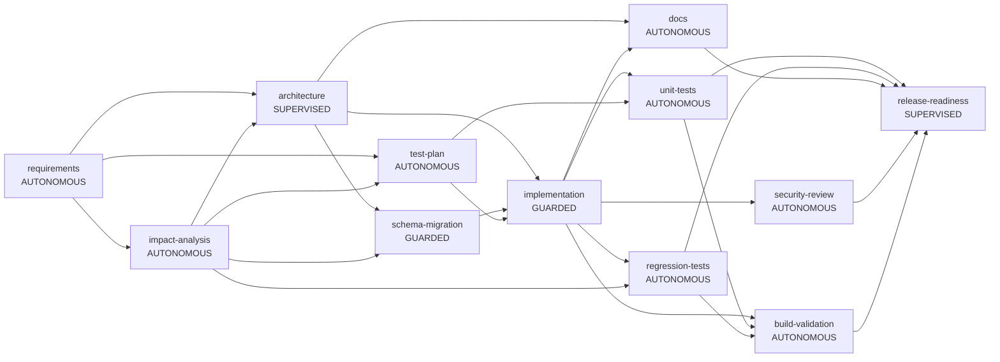

# Final Engineering Summary: run-d406e62a (brownfield)

**Outcome:** COMPLETED

## 1. Plan and rationale
**Original request:** Add per-IP rate limiting on link creation and a clicks-per-day analytics breakdown to the existing shortener without changing the redirect contract.

### Requirements

## Problem
Deliver the requested URL shortener capability with measurable reliability and safe change control.

## Assumptions
- Short codes are Base62, 7 chars
- Redirects use HTTP 302 so analytics are not bypassed by caches
- Single region; a relational DB is the system of record

## Task decomposition
- T1: Design API, schema and components (depends: none)
- T2: Test plan (depends: none)
- T3: Implement service (depends: T1, T2)
- T4: Unit and integration tests (depends: T3)
- T5: Security review and docs (depends: T3)
- T6: Release readiness (depends: T4, T5)

**Execution graph** (entry/exit gates, parallel branches join before dependants):

## 2. Artifacts and lineage
| Artifact | Produced by | SHA-256 | Derived from |
|---|---|---|---|
| architecture@1 | agent:architect+approved-by:reviewer | 6b7db27c5c | requirements@1, impact-analysis@1 |
| clarifications@1 | human:requester | e3b0c44298 | - |
| codebase-snapshot@1 | human:requester | 23c3a0b0aa | - |
| docs@1 | agent:docs-writer | a06b9d6b34 | architecture@1, implementation@1 |
| impact-analysis@1 | agent:impact-analyst | edd3f93cda | requirements@1, codebase-snapshot@1 |
| implementation@1 | agent:implementer | c5dcfb9710 | architecture@1, schema-migration@1, test-plan@1 |
| open-questions@1 | agent:requirements-analyst | e3b0c44298 | requirement@1, clarifications@1 |
| regression-tests@1 | agent:regression-test-writer | 60c93cd1d7 | implementation@1, impact-analysis@1 |
| release-notes@1 | agent:release-manager+approved-by:reviewer | 1419a93494 | unit-tests@1, regression-tests@1, docs@1, security-review@1, validation-report@1 |
| requirement@1 | human:requester | 63d1dccb61 | - |
| requirements@1 | agent:requirements-analyst | 18b7a5f1fb | requirement@1, clarifications@1 |
| schema-migration@1 | agent:migration-author+approved-by:reviewer | b2f0b800db | architecture@1, impact-analysis@1 |
| security-review@1 | agent:security-reviewer | d8771b59e6 | implementation@1 |
| test-plan@1 | agent:test-planner | 2b07749629 | requirements@1, impact-analysis@1 |
| unit-tests@1 | agent:unit-test-writer | 5e948b776c | implementation@1, test-plan@1 |
| validation-report@1 | agent:build-validator | 2f2cfaf052 | implementation@1, unit-tests@1, regression-tests@1 |

Superseded versions are retained in the audit trail (16 versions total).

## 3. Human oversight and guardrail decisions
- `APPROVAL_REQUESTED` architecture: supervised node: human sign-off required
- `APPROVED` architecture: LGTM | reviewer
- `APPROVAL_REQUESTED` schema-migration: high-impact-change: touches controlled file 'src/main/resources/db/migration/V2__click_daily_rollup.sql' | high-impact node
- `APPROVED` schema-migration: LGTM | reviewer
- `APPROVAL_REQUESTED` release-readiness: supervised node: human sign-off required
- `APPROVED` release-readiness: LGTM | reviewer

## 4. Validation and reliability
- MODE: SIMULATED (commands were NOT executed)
- FILES OVERLAID: 4
- RESULT: PASSED

| Metric | Value |
|---|---|
| Node success rate | 100% (12 ok / 0 failed) |
| Retries / fallbacks / rollbacks | 0 / 0 / 0 |
| Re-plans | 0 |
| Policy denials / gate failures | 0 / 0 |
| Approvals requested / granted / rejected | 3 / 3 / 0 |
| MTTR (failed attempt -> valid output) | 0 ms |
| End-to-end latency | 134 ms (human wait 9 ms, agent-active 125 ms) |

## 5. Assumptions
- Short codes are Base62, 7 chars
- Redirects use HTTP 302 so analytics are not bypassed by caches
- Single region; a relational DB is the system of record

## 6. Risks, trade-offs and limitations
- **Build validation was SIMULATED in this run**: generated code was not compiled or tested. Real mode runs allowlisted `mvn` commands.
- Waves are atomic: one permanent failure discards sibling results of that wave (consistency over throughput).
- Policy checks are pattern-based and can miss novel leaks; they complement, not replace, review and SAST.
- A failed build escalates to a human; there is no automatic repair loop yet.
- Run state is in memory; the JSONL audit log survives restarts but runs are not yet rebuilt from it.
