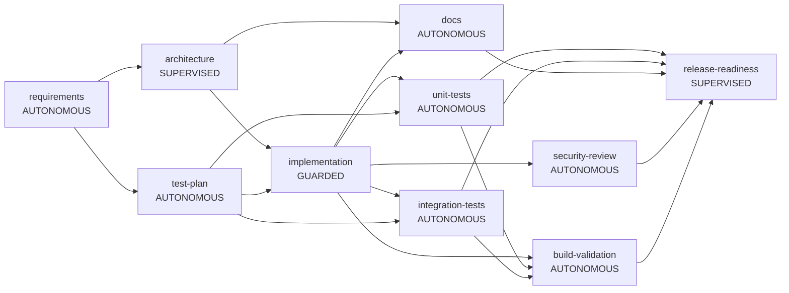

# Final Engineering Summary: run-941b3d5c (greenfield)

**Outcome:** COMPLETED

## 1. Plan and rationale
**Original request:** Build a URL shortener: create short links (optional expiry), redirect by code, per-link click stats, and basic reliability (validation, rate limiting, clear error codes).

### Requirements

## Problem
Deliver the requested URL shortener capability with measurable reliability and safe change control.

## Assumptions
- Short codes are Base62, 7 chars
- Redirects use HTTP 302 so analytics are not bypassed by caches
- Single region; a relational DB is the system of record

## Task decomposition
- T1: Design API, schema and components (depends: none)
- T2: Test plan (depends: none)
- T3: Implement service (depends: T1, T2)
- T4: Unit and integration tests (depends: T3)
- T5: Security review and docs (depends: T3)
- T6: Release readiness (depends: T4, T5)

**Execution graph** (entry/exit gates, parallel branches join before dependants):

## 2. Artifacts and lineage
| Artifact | Produced by | SHA-256 | Derived from |
|---|---|---|---|
| architecture@1 | agent:architect+approved-by:reviewer | dda7d330f3 | requirements@1 |
| clarifications@1 | human:requester | e3b0c44298 | - |
| docs@1 | agent:docs-writer | a06b9d6b34 | architecture@1, implementation@1 |
| implementation@1 | agent:implementer | 2970bf7712 | architecture@1, test-plan@1 |
| integration-tests@1 | agent:integration-test-writer | a1d7519c94 | implementation@1, test-plan@1 |
| open-questions@1 | agent:requirements-analyst | e3b0c44298 | requirement@1, clarifications@1 |
| release-notes@1 | agent:release-manager+approved-by:reviewer | 1419a93494 | unit-tests@1, integration-tests@1, docs@1, security-review@1, validation-report@1 |
| requirement@1 | human:requester | 623432a7bc | - |
| requirements@1 | agent:requirements-analyst | 18b7a5f1fb | requirement@1, clarifications@1 |
| security-review@1 | agent:security-reviewer | d8771b59e6 | implementation@1 |
| test-plan@1 | agent:test-planner | 2b07749629 | requirements@1 |
| unit-tests@1 | agent:unit-test-writer | 5e948b776c | implementation@1, test-plan@1 |
| validation-report@1 | agent:build-validator | 2f2cfaf052 | implementation@1, unit-tests@1, integration-tests@1 |

Superseded versions are retained in the audit trail (13 versions total).

## 3. Human oversight and guardrail decisions
- `APPROVAL_REQUESTED` architecture: supervised node: human sign-off required
- `APPROVED` architecture: reviewer | LGTM
- `APPROVAL_REQUESTED` release-readiness: supervised node: human sign-off required
- `APPROVED` release-readiness: reviewer | LGTM

## 4. Validation and reliability
- MODE: SIMULATED (commands were NOT executed)
- FILES OVERLAID: 4
- RESULT: PASSED

| Metric | Value |
|---|---|
| Node success rate | 100% (10 ok / 0 failed) |
| Retries / fallbacks / rollbacks | 0 / 0 / 0 |
| Re-plans | 0 |
| Policy denials / gate failures | 0 / 0 |
| Approvals requested / granted / rejected | 2 / 2 / 0 |
| MTTR (failed attempt -> valid output) | 0 ms |
| End-to-end latency | 153 ms (human wait 8 ms, agent-active 145 ms) |

## 5. Assumptions
- Short codes are Base62, 7 chars
- Redirects use HTTP 302 so analytics are not bypassed by caches
- Single region; a relational DB is the system of record

## 6. Risks, trade-offs and limitations
- **Build validation was SIMULATED in this run**: generated code was not compiled or tested. Real mode runs allowlisted `mvn` commands.
- Waves are atomic: one permanent failure discards sibling results of that wave (consistency over throughput).
- Policy checks are pattern-based and can miss novel leaks; they complement, not replace, review and SAST.
- A failed build escalates to a human; there is no automatic repair loop yet.
- Run state is in memory; the JSONL audit log survives restarts but runs are not yet rebuilt from it.
